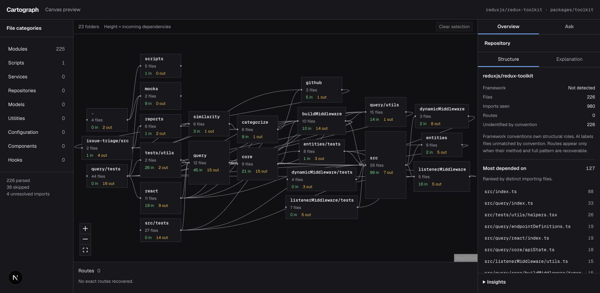

# Cartograph

Turn a public GitHub repository into an interactive dependency map. Explore what a file imports, what depends on it, and how a change could propagate through the codebase. Ask for explanations or question the repository through an agent that looks up recorded facts.

**Every node and edge comes from parsing real code.** AI explains and labels what the parser found; it never invents connections. Unresolved imports and skipped files are reported with reasons.

## Project showcase

Explore the [screenshot walkthrough](docs/showcase/README.md) for a quick look at the working app, its architecture, and recorded agent behaviour. These examples use real parsed repositories. Viewing the showcase makes no AI requests and requires no account.



*Saved Redux Toolkit analysis: 226 parsed files, 23 folded folders, and visible coverage gaps.*


*Recorded Ask session on a separate public NestJS repository. The live application stays local; this is a screenshot, not an interactive chat.*

## What it does

- **Interactive maps:** fold folders, expand files, inspect incoming and outgoing imports, and follow clickable file references.
- **Structural analysis:** see fan-in, fan-out, dependency chains, and blast radius calculated from the resolved edge list.
- **Framework context:** adapters recognise Next.js, React, NestJS, and Express conventions. Route tables include only fully recoverable methods and paths.
- **Coverage reporting:** inspect parsed files, exclusions, skipped files, and unresolved imports rather than hiding gaps.
- **Grounded AI:** request file or folder explanations and classify files unmatched by framework conventions, with cached responses and optional LangSmith tracing.
- **Repository questions:** the Ask pane streams answers and shows the agent's repository lookups. Its tools use the same graph calculations as the map.
- **Team workspaces:** Clerk organizations share stored analyses, with Supabase row-level security enforcing access and Realtime delivering progress.
- **Public landing page:** submit a repository URL before sign-in, with light, dark, and system themes throughout the app.

## Stack

| Area | Technology |
| --- | --- |
| Application | Next.js 16 App Router, React 19, strict TypeScript |
| Parsing | ts-morph and TypeScript module resolution |
| Map | React Flow and dagre |
| Styling | Tailwind CSS v4 |
| Identity and teams | Clerk |
| Storage and live progress | Supabase Postgres, RLS, and Realtime |
| Explanations and classification | OpenAI SDK, traced with LangSmith |
| Ask service | Managed Deep Agents and LangChain |
| Tooling | Node.js and pnpm |

## Run locally

Use Node **24.15.0** from [`.nvmrc`](.nvmrc) and pnpm **10.34.6**. You will need Clerk and Supabase projects, an OpenAI API key for AI features, and a LangSmith API key for the Ask service.

```sh
nvm use
pnpm install --frozen-lockfile
pnpm --dir deep-agent install --frozen-lockfile
```

### 1. Configure identity and storage

Follow [the setup guide](docs/setup.md#clerk-configuration) to enable Clerk Organizations, automatic first-organization creation, and the native Clerk–Supabase integration. Link the Supabase CLI to the matching project, then apply **all** tracked migrations:

```sh
supabase db push
```

The setup guide also covers Realtime, optional seed data, database verification, and the Clerk organization-deletion webhook. Seeding is not required to analyse a repository.

### 2. Set the app environment

Create `.env.local` at the repository root:

```dotenv
NEXT_PUBLIC_CLERK_PUBLISHABLE_KEY=
CLERK_SECRET_KEY=
NEXT_PUBLIC_SUPABASE_URL=
NEXT_PUBLIC_SUPABASE_PUBLISHABLE_KEY=

OPENAI_API_KEY=

# App-only random signing secret: at least 32 bytes.
CARTOGRAPH_AGENT_SIGNING_SECRET=
CARTOGRAPH_AGENT_URL=http://127.0.0.1:2024
# A separate random secret, shared with deep-agent/.env.
MDA_INGRESS_SECRET=
```

Use the Supabase **publishable** key for application access. The secret database key is reserved for the verified deletion webhook; see [webhook configuration](docs/setup.md#clerk-deletion-webhook) for its separate environment values.

For app explanation and classification traces, optionally add:

```dotenv
LANGSMITH_API_KEY=
LANGSMITH_TRACING=true
LANGSMITH_PROJECT=Cartograph
# Only if your key requires explicit workspace selection:
# LANGSMITH_WORKSPACE_ID=
```

An optional `GITHUB_TOKEN` raises the API rate limit for explanation freshness checks. Repository downloads do not require it. Keep credentials in ignored environment files.

### 3. Configure the Ask service

```sh
cp deep-agent/.env.example deep-agent/.env
```

Fill in `OPENAI_API_KEY` and `LANGSMITH_API_KEY` in that file. Set `MDA_INGRESS_SECRET` to the same value as the app, and keep `CARTOGRAPH_APP_URL=http://127.0.0.1:3000`. The signing secret stays only in the app environment.

See [the agent README](deep-agent/README.md) for runtime and tool details. Its pnpm scripts use their own Node 22 runtime.

### 4. Start both services

Run the app in one terminal:

```sh
pnpm dev
```

Run the Ask service in another:

```sh
pnpm --dir deep-agent start
```

Open [localhost:3000](http://localhost:3000), sign in, and submit a public repository URL such as `https://github.com/sindresorhus/p-limit`. Once analysis completes, explore the map, select a file for its structure or explanation, or switch to Ask.

The map and explanation features work independently of the Ask service. Keep the local agent development server private.

## Standalone parser

Parse a local directory without starting the app or configuring external services:

```sh
pnpm parse /path/to/repository --output /tmp/cartograph.json
```

The parser resolves imports, re-exports, literal dynamic imports, and unshadowed `require()` calls. It honours the nearest `tsconfig.json` or `jsconfig.json`, including aliases, and returns files, edges, and coverage as validated JSON. See [parser documentation](docs/parser.md).

## Verification

Core application checks:

```sh
pnpm typecheck
pnpm lint
pnpm build
```

Parser and agent tool checks that do not call a model:

```sh
pnpm verify:parser
pnpm verify:agent-tools
pnpm verify:agent-stream
pnpm --dir deep-agent typecheck
pnpm --dir deep-agent verify:tools
pnpm --dir deep-agent build
```

The [setup guide](docs/setup.md) documents additional graph, pipeline, database, AI, and evaluation commands and their prerequisites. Browser acceptance checks live in each phase spec and are run manually.

## Boundaries

Cartograph supports **public TypeScript and JavaScript repositories**. It downloads a pinned commit archive and never installs or executes the analysed repository's code. Archive limits are 50 MiB downloaded, 200 MiB expanded, and 50,000 entries.

It explains structure rather than reviewing code: no quality scores, severity ratings, or guessed dependencies. Framework routes that cannot be recovered exactly are omitted. Private repositories and other source languages are outside the current scope. Analyses run in the app process, so large repositories and model context limits can fail explicitly; there is no background job queue.

## Project documentation

- [Project decisions](docs/project-doc.md) — product scope, architecture, and reasoning.
- [Local setup](docs/setup.md) — service configuration, migrations, and terminal verification.
- [Phase specifications](docs/specs/) — behaviour and manual acceptance checks for all 13 phases.
- [Canvas](docs/canvas.md) — map behaviour and graph calculations.
- [Agent service](deep-agent/README.md) — runtime, lookup tools, and app integration.
- [Agent evaluations](evals/agent/README.md) — behaviour checks against recorded parser truth.
- [Contributor instructions](AGENTS.md) — repository rules for spec-driven development.
