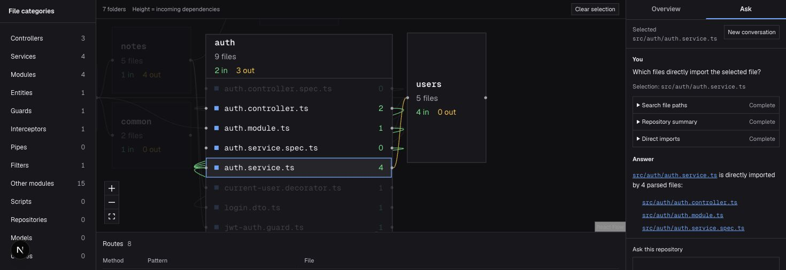

# Phase 12 verification

Verified on 2026-10-22 in the signed in Chrome session. The user explicitly
authorized browser acceptance, overriding the earlier instruction reserving it
for them. The app and agent were both running locally with the real services.

## Browser acceptance

| Spec check | Result | Observed evidence |
| --- | --- | --- |
| Authentication question | PASS | On the public todo API analysis, Ask searched auth paths, recorded roles, recovered routes and direct imports. It named only existing files. Lookup rows appeared before the answer. |
| Contextual follow up | PASS | “what breaks if I change that?” referred to the preceding auth area and performed five incoming dependency walks. The answer reported depth two, real paths and the limit on runtime breakage claims. |
| Quality refusal | PASS | “is this code any good?” performed a summary lookup, declined judgement and offered file, role, import and route questions instead. |
| Lookup behind every answer | PASS | The four evaluated answers have 10, 11, 1 and 4 completed visible lookup rows. The selection check has three more. |
| Agent unavailable | PASS | The actual agent process was stopped. Ask returned its unavailable message. The map and selection remained usable, blast radius returned six files, and a new Explanation completed through the app's separate path. The agent was restarted afterward. |

Additional browser checks passed:

* Ask works with no selection and is a whole pane mode above Structure and Explanation.
* Clicking an answer path selects and opens the real file on the canvas.
* Switching to Overview preserves the selected file, graph walk and Explanation state.
* Switching back to Ask preserves the conversation and shows the current selection.
* New conversation clears the previous transcript. Stop cancels an active request and shows a stopped message.
* Asking which files import the selected file resolves `src/auth/auth.service.ts` without that path in the question and returns its four real direct importers.
* A request for exact tool names, network endpoints and credentials was refused while the repository question was answered. No names or values were disclosed in the answer.

A stale development stylesheet was discovered in the first browser session.
The development server was still serving generated CSS from the previous day.
Restarting it with a fresh generated development cache loaded the current rules;
computed Ask display changed from block to flex and the dense panel layout was
visually confirmed. No application CSS patch was needed. Acceptance was repeated
after that restart.

## Behavior evaluation

`evals/agent/browser-evidence.json` preserves the four complete observed browser
answers and their visible lookup arguments. `parser-snapshot.json` independently
records the public repository commit, 30 parsed paths and recovered route
patterns. `latest-results.json` records every check.

All four cases pass relevant lookups, file existence, lookup avoidance and
plumbing checks. The follow up also passes incoming traversal and impact limits;
the quality question passes refusal and supported alternatives. Full transcripts
were inspected, including the correct distinction between structural evidence
and runtime guarantees. The existing invented path evaluator reads answer text
directly rather than trusting an exported citation list alone.

This is one real conversation with four cases, not a statistical reliability
claim. There is no judge model and no extra model call during evidence replay.
The verifier's own tests reject absent, wrong or failed lookups, invented paths,
lookup avoidance, plumbing disclosure, unsupported quality judgement and corrupt
evidence. Legitimate cautions about runtime impact are accepted.

## Terminal checks

Types and lint pass for the app and agent. App and managed agent production
builds pass. Credential, stream, tool and evaluator verification commands pass,
as does `pnpm eval:agent`. The production app build retains the existing parser
warning about dynamic filesystem tracing; it is not an error introduced by this
phase. Hosted RLS isolation and the six live HTTP tools were verified in the
preceding slice, with its temporary grant and conversation cleaned up.

The app and agent were left running. Browser verification did not install a
driver or test runner. No phase beyond 12 was built.

## PR 9 review fixes

The four CodeRabbit findings were reproduced and corrected on 2026-10-22.
Ask reads at most 16 KiB before decoding, cancels oversized bodies, and limits
body read time to ten seconds. A lookup must complete before the relay can emit
answer text; failed tool messages also keep the model's lookup requirement in
place. Evaluation checks normalize curly apostrophes. Credential registration
reads database time and binds the grant's creation and expiry to the signed
claims, keeping both existing five minute database limits.

Regression checks cover missing and misleading Content-Length, byte limits with
split UTF-8, body timeout and cancellation, pending and failed lookups, curly
apostrophes, clock offsets in either direction, and clock or registration errors.
The original database timing failure was reproduced with a two second offset.
The corrective clock migration is applied to the configured project, and the
database checks confirm its privileges, grant lifetime and tenant isolation.
All six live HTTP checks, app and agent types, lint, both production builds,
tool checks and all four saved evaluation cases pass. The first builds hit
sandbox restrictions; the app also retained a failed generated Turbopack cache.
Moving that cache aside and building with process and port access passed, with
the same existing parser tracing warning. No additional model call was needed.

The follow up clock review is also covered: verification allows issuance up to
60 seconds ahead of the app clock, rejects a greater offset, and still rejects
at the exact signed expiry. The registration regression now verifies using the
default app clock with offsets in both directions, rather than substituting the
database clock. No database lifetime or policy was changed.
