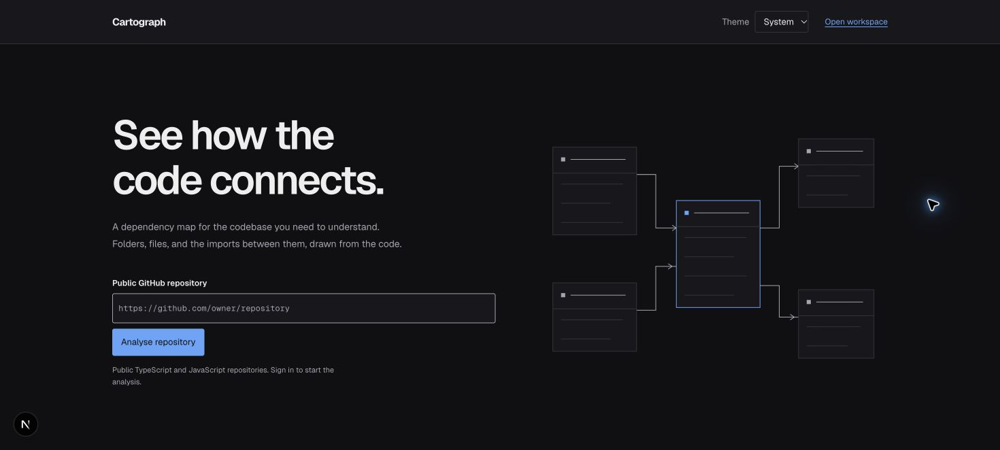
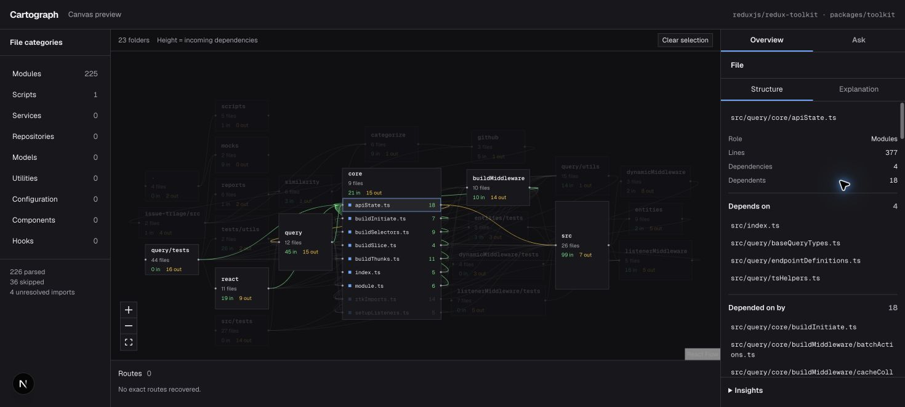

# Cartograph showcase

Cartograph helps developers understand an unfamiliar TypeScript or JavaScript repository by turning resolved imports into an interactive map. Select a file to inspect its dependencies, trace potential impact, or ask an agent a structural question.

This showcase uses screenshots and previously recorded evidence. It requires no account and makes no OpenAI requests. The full application runs locally; no public service is deployed.

## The product

The landing page introduces the product and accepts a public GitHub repository URL. In the working app, authentication leads into an organization workspace and repository analysis.

## A map grounded in code

This is real checked-in parser output for `reduxjs/redux-toolkit`, restricted to `packages/toolkit`, at commit `0fd611cc79d44990ac9a040dec4d5cb446233440`. It contains 226 parsed files, grouped into 23 folded folders. The interface also reports 36 skipped files and four unresolved imports.

Folders expand into files. Edges represent resolved imports, and incoming and outgoing connections use different colours. The parser reports gaps instead of filling them with guessed relationships.

## Follow the dependencies

In this saved analysis, `src/query/core/apiState.ts` has four direct dependencies and 18 direct dependents. Selecting it exposes the actual paths and highlights its connections. Blast radius follows incoming imports up to two levels; dependency chain follows outgoing imports. These are graph calculations, not model predictions about runtime failures.

## See what the agent looked up

This separate recorded session uses `harshnanhaswani/todo-api`. The selected file is `src/auth/auth.service.ts`, and the question asks which files directly import it. The answer follows visible completed lookups and names real file paths.

The [saved conversation evidence](../../evals/agent/browser-evidence.json) also contains authentication discovery, a contextual impact follow-up, a refusal to grade code, and a request probing internal details. An [independent parser snapshot](../../evals/agent/parser-snapshot.json) supplies the reference paths and routes. The [evaluation documentation](../../evals/agent/README.md) explains the checks and their limits. Four recorded cases are a small behaviour sample, not a general accuracy claim.

## Engineering decisions

| Decision | Purpose | Implementation evidence |
| --- | --- | --- |
| Keep parsing independent of the web app | Run it from a directory path without React, database access, or AI | [Parser](../../lib/parser/parse.ts) |
| Resolve edges before calling a model | Keep structural claims tied to real imports | [Parser contract](../../lib/parser/types.ts) |
| Reuse pure graph functions | Keep the map and agent traversal consistent | [Graph calculations](../../lib/canvas/graph.ts), [tool queries](../../lib/agent/queries.ts) |
| Enforce organization access in Postgres | Keep tenant isolation at the data layer | [Migrations](../../supabase/migrations/), [setup and verification](../setup.md) |
| Give the agent short-lived access to one analysis | Scope repository lookup access without broad database credentials | [Credential issuance](../../lib/agent/issue.ts), [grant validation](../../lib/agent/grant.ts) |
| Put cache reads inside explanation traces | Make cache hits observable without a model call | [AI client](../../lib/ai/client.ts), [cache](../../lib/ai/cache.ts) |
| Replay recorded answers against independent parser truth | Check grounded behaviour without spending on new model calls | [Agent evaluator](../../evals/agent/evaluate.ts) |

## Presentation materials

- [Two-minute walkthrough script](walkthrough.md), with a sequence that requires no new AI calls.
- [Application copy](application-copy.md), with a project summary, resume bullets, and interview talking points.
- [Full project README](../../README.md), with setup and verification commands.

## Screenshot provenance

`landing.jpg`, `dependency-map.jpg`, and `file-structure.jpg` were captured from the local application on 22 October 2026. The map captures use the existing `/preview` route and its saved parser fixture. The Ask image comes from the existing phase 12 verification record. It is a historical capture, not a newly generated answer. Images are unaltered browser captures and include the local development indicator.

No new analysis, explanation, or agent conversation was submitted to create this package. No credentials, private repository source, or account details appear in the images.
